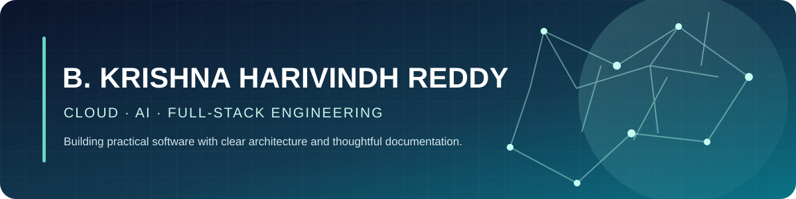

  
   
  
  
  
    
  
  

## About

I’m a Computer Science and Engineering student at **SRM Institute of Science and Technology**, specializing in **Cloud Computing**. I build practical software across AI, full-stack engineering, cloud systems, cybersecurity, and test automation—with an emphasis on clear documentation and reproducible setup.

## Focus Areas

- **AI and LLMs:** RAG, semantic search, agent workflows, model evaluation, and explainability
- **Application engineering:** React, TypeScript, FastAPI, Node.js, REST APIs, and PostgreSQL
- **Cloud and security:** AWS, Azure, OCI, Docker, authentication, RBAC, and audit logging
- **Quality engineering:** MCP-based workflows, requirements analysis, and browser automation

## Featured Projects

<table>
  <tr>
    <td width="50%" valign="top">
      <strong><a href="https://github.com/KrishnaHarivindh/ai-powered-project-governance-platform">AI Powered Project Governance Platform</a></strong> 
      A monorepo bringing together project and life management, PMO oversight, project operations, an enterprise AI copilot, and SOC monitoring. 
      React · TypeScript · FastAPI · Node.js · PostgreSQL
    </td>
    <td width="50%" valign="top">
      <strong><a href="https://github.com/KrishnaHarivindh/mcp-appium">AI-Driven QA &amp; Test Automation using MCP</a></strong> 
      Requirements analysis and app exploration workflows for test design, automation planning, and QA review. 
      MCP · Appium · Playwright · Selenium · Cypress
    </td>
  </tr>
  <tr>
    <td width="50%" valign="top">
      <strong><a href="https://github.com/KrishnaHarivindh/nanosim360">NanoSim360</a></strong> 
      An educational nanomaterials explorer with scientific calculations and clearly bounded synthetic ML estimates. 
      Python · FastAPI · React · TypeScript
    </td>
    <td width="50%" valign="top">
      <strong><a href="https://github.com/KrishnaHarivindh/Project-Lelouch">GEASSFLOW</a></strong> 
      Natural-language workflow automation with dynamic tool selection and execution tracing. 
      TypeScript · React · Node.js · Docker
    </td>
  </tr>
  <tr>
    <td width="50%" valign="top">
      <strong><a href="https://github.com/KrishnaHarivindh/transmission-ml-analysis-system">Transmission ML Analysis System</a></strong> 
      Prediction and benchmarking tools for automobile transmission analysis, with sensitivity studies and report exports. 
      Python · Pandas · Scikit-Learn · XGBoost
    </td>
    <td width="50%" valign="top">
      <strong><a href="https://github.com/KrishnaHarivindh/fanet-peer-selection-cooja">FANET Peer Selection Cooja Demo</a></strong> 
      A Contiki-NG simulation of an illustrative multi-hop disaster-response peer-selection flow. 
      C · Contiki-NG · Cooja
    </td>
  </tr>
</table>

<a href="https://github.com/KrishnaHarivindh?tab=repositories">Explore all repositories →</a>

## Experience

- **Machine Learning Research Intern · DRDO CVRDE** — Worked on temperature and friction-power prediction for automobile transmission systems using feature engineering, model benchmarking, and industrial data analysis.
- **AWS Cloud Virtual Internships · AICTE / EduSkills** — Studied AWS cloud fundamentals and generative AI, including IAM, networking, compute, storage, foundation models, and responsible AI.

## Skills

| Area | Tools and technologies |
| --- | --- |
| Languages | Python, Java, TypeScript, JavaScript, SQL, C++ |
| Frontend | React, Vite, HTML, CSS, Tailwind CSS |
| Backend and data | FastAPI, Node.js, Express, PostgreSQL, MySQL, SQLite, SQLAlchemy, Alembic |
| AI and machine learning | RAG, pgvector, TensorFlow, Keras, Scikit-Learn, XGBoost, LightGBM, Pandas, NumPy |
| Cloud and engineering | AWS, Azure, Oracle Cloud, Docker, GitHub Actions |
| Security and QA | JWT, RBAC, audit logging, MCP, Selenium, Playwright, Cypress |

## Certifications

**Cloud and AI:** Oracle Cloud Infrastructure Generative AI Professional; OCI Foundations Associate; AWS Academy Cloud Foundations, Cloud Architecting, Generative AI, and Machine Learning; IBM Cloud Computing Fundamentals 
**Data and programming:** Microsoft Azure Data Fundamentals (DP-900); Data Engineering on AWS Foundations; NPTEL Database Management Systems and Programming in Java 
**Networking and security:** Fortinet Certified Associate Cybersecurity; Cisco Networking Devices and Initial Configuration; Zscaler Zero Trust Cyber Associate

## GitHub Activity

  
  

  Always learning, building, and improving.

